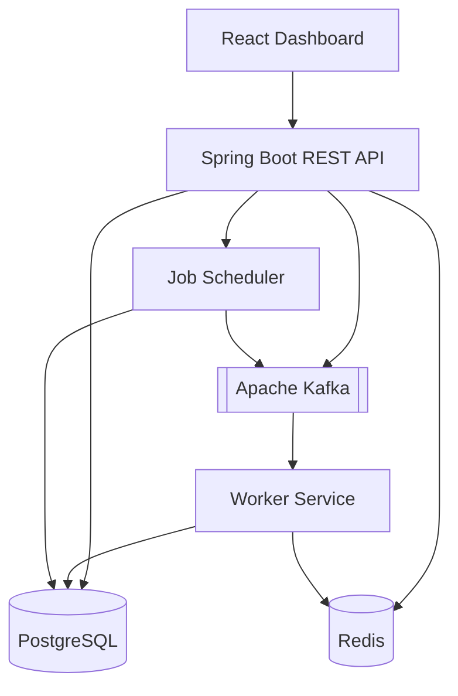

# ⚡ QueueX — Distributed Job Queue Platform

<p align="center">
  
  
  
  
  
  
  
</p>

<p align="center">
  <strong>Reliable Background Processing. Distributed Execution. Complete Visibility.</strong>
  <br /><br />
  A Docker-first distributed job queue platform built with Java 21, Spring Boot, Apache Kafka, PostgreSQL, Redis, and React.
</p>

---

## 📌 Overview

**QueueX** is a distributed job queue platform designed to submit, schedule, distribute, execute, and monitor background tasks across independent worker services.

It provides a centralized REST API for job management, Kafka-powered message dispatching, PostgreSQL-based persistent job tracking, and Redis-powered worker monitoring.

The platform demonstrates important distributed systems concepts, including asynchronous processing, message-driven architecture, retry mechanisms, worker coordination, and fault-tolerant job execution.

## ✨ Key Features

### ⚙️ Job Management
- Submit jobs through REST APIs.
- Inspect job details and execution history.
- Cancel pending jobs and manually retry failed jobs.
- Support job priorities and delayed execution.
- Track job execution attempts and status.

### 🔄 Distributed Processing
- Kafka-based job dispatching.
- Separate worker service for background execution.
- Transactional database state transitions when claiming jobs.
- Periodic scheduling and dispatch of due jobs.
- Redis-based worker heartbeats and status monitoring.

### 🛡️ Reliability and Security
- Exponential backoff retry mechanism.
- Dead-letter state after maximum execution attempts.
- Persistent job state using PostgreSQL.
- JWT-based registration and authentication.
- Protected job and worker API endpoints.

### 📊 Dashboard and Monitoring
- React-based management dashboard.
- Job submission and status monitoring.
- Job filtering and manual refresh.
- Worker status visibility.
- Swagger API documentation and health endpoints.

## 🏗️ System Architecture



### How It Works

1. **Job Submission:** The user submits a job through the React dashboard or REST API.
2. **Persistence:** The Spring Boot API stores the job and its initial state in PostgreSQL.
3. **Dispatching:** Kafka distributes job messages to the worker service.
4. **Execution:** Workers claim eligible jobs using transactional database state transitions.
5. **Monitoring:** Redis stores worker heartbeats, allowing the API to expose worker status.
6. **Retry Handling:** Failed jobs are retried using exponential backoff.
7. **Dead State:** Jobs that exhaust their configured attempts enter the `DEAD` state and can be manually retried.

## 🧰 Technology Stack

| Layer | Technologies |
|---|---|
| Backend | Java 21, Spring Boot |
| Frontend | React |
| Messaging | Apache Kafka |
| Database | PostgreSQL |
| Worker Monitoring | Redis |
| Authentication | JWT |
| API Documentation | OpenAPI / Swagger |
| Containerization | Docker, Docker Compose |

## 📁 Project Structure

```text
QueueX/
│
├── backend/             # Spring Boot REST API
│   └── pom.xml
│
├── worker/              # Independent background worker
│   └── pom.xml
│
├── frontend/            # React dashboard
│   └── package.json
│
├── docker-compose.yml   # Multi-service orchestration
├── .env.example         # Environment configuration template
└── README.md
```

## 🚀 Getting Started

### Prerequisites

The easiest way to run QueueX is with:

- Docker Desktop or Docker Engine
- Docker Compose

For local development, you will also need Java 21, Maven, and Node.js.

### 1. Clone the Repository

```bash
git clone <YOUR_GITHUB_REPOSITORY_URL>
cd QueueX
```

### 2. Configure Environment Variables

```bash
cp .env.example .env
```

Update `.env` with the appropriate configuration for your environment.

### 3. Start the Application

```bash
docker compose up --build
```

Docker Compose builds and starts the application services.

### 4. Access the Application

| Service | URL |
|---|---|
| React Dashboard | http://localhost:5173 |
| Backend API | http://localhost:8080 |
| Swagger UI | http://localhost:8080/swagger-ui.html |
| API Health | http://localhost:8080/actuator/health |

## 🔐 Authentication

QueueX uses JWT authentication to protect job management and worker endpoints.

Register an account using:

**Endpoint:** `POST /api/auth/register`

```json
{
  "email": "demo@example.com",
  "password": "ChangeMe123!"
}
```

Log in using:

**Endpoint:** `POST /api/auth/login`

Use the returned JWT as a Bearer token when accessing protected endpoints:

```http
Authorization: Bearer <token>
```

## 📤 Submitting a Job

Submit a job using:

**Endpoint:** `POST /api/jobs`

Example request:

```json
{
  "type": "uppercase",
  "payload": {
    "text": "hello queuex"
  },
  "priority": 8,
  "maxAttempts": 4
}
```

### Supported Demo Job Types

| Job Type | Description |
|---|---|
| `echo` | Returns the supplied input |
| `uppercase` | Converts text to uppercase |
| `sleep` | Simulates a time-consuming task |
| `fail` | Simulates a failed execution |

### Delayed Job Execution

A delayed job can use `scheduledAt` with an ISO-8601 timestamp.

Example:

```json
{
  "type": "echo",
  "payload": {
    "text": "Scheduled task"
  },
  "scheduledAt": "2026-12-01T10:30:00"
}
```

### Retry Mechanism

QueueX uses exponential backoff to retry failed jobs.

When a job reaches its configured `maxAttempts`, it enters the `DEAD` state. Dead jobs can be manually retried through the API.

## 📡 API Reference

| Method | Endpoint | Description |
|---|---|---|
| POST | `/api/auth/register` | Register a new account |
| POST | `/api/auth/login` | Authenticate and obtain JWT |
| POST | `/api/jobs` | Submit a new job |
| GET | `/api/jobs` | Retrieve jobs |
| GET | `/api/jobs/{id}` | Get job details |
| POST | `/api/jobs/{id}/cancel` | Cancel a job |
| POST | `/api/jobs/{id}/retry` | Retry a job |
| GET | `/api/workers` | Retrieve worker status |
| GET | `/actuator/health` | Check API health |

All `/api/jobs` and `/api/workers` endpoints require JWT authentication.

For complete API documentation, open the Swagger UI after starting the application.

## 🧪 Local Development

You can also run the services independently.

**Backend API**

```bash
cd backend
mvn spring-boot:run
```

**Worker Service**

```bash
cd worker
mvn spring-boot:run
```

**Frontend Dashboard**

```bash
cd frontend
npm install
npm run dev
```

Configure the same environment variables used in `.env.example` before starting the services.

## 🔍 Distributed Systems Concepts

QueueX demonstrates several important concepts:

- **Message Queues:** Asynchronous communication through Kafka.
- **Worker Architecture:** Independent services process background tasks.
- **Persistence:** PostgreSQL maintains job states and execution attempts.
- **Heartbeats:** Redis tracks worker activity.
- **Retry Strategies:** Exponential backoff handles temporary execution failures.
- **Scheduling:** Delayed jobs are dispatched when they become due.
- **Transactional Claiming:** Database state transitions prevent duplicate execution when Kafka messages are delivered more than once.

### Delivery Semantics

Kafka provides at-least-once delivery in this architecture. Transactional job claiming helps prevent duplicate execution of the same job, but external side effects may still require idempotent handlers.

## 🔒 Production Considerations

Before deploying QueueX in a production environment:

- Replace the demo JWT secret with a secure secret.
- Enable HTTPS/TLS.
- Configure secure Kafka, PostgreSQL, and Redis credentials.
- Implement authorization policies appropriate to your tenancy model.
- Use idempotent job handlers for external side effects.
- Configure backups, logging, monitoring, and operational alerts.

## 🎯 Project Objectives

QueueX was developed to explore and demonstrate:

- Distributed backend architecture.
- Java and Spring Boot development.
- Kafka-based asynchronous processing.
- Database-backed job lifecycle management.
- Redis worker monitoring.
- Authentication and protected REST APIs.
- Docker-based multi-service deployment.
- React dashboard development.

## 👨‍💻 Developer

**Developed by Lakshya Kansal**

Full-Stack Developer | MCA Student | Software Development Enthusiast

Interested in building scalable backend systems, distributed applications, and modern software solutions.

---

<p align="center">
  <strong>⚡ QueueX — Powering Reliable Background Job Processing.</strong>
  <br /><br />
  If you find this project interesting, consider giving it a ⭐ on GitHub!
</p>
